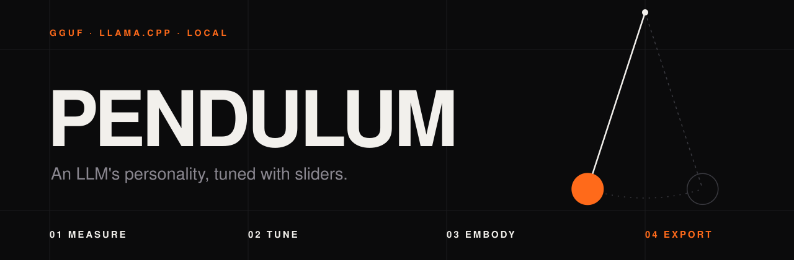
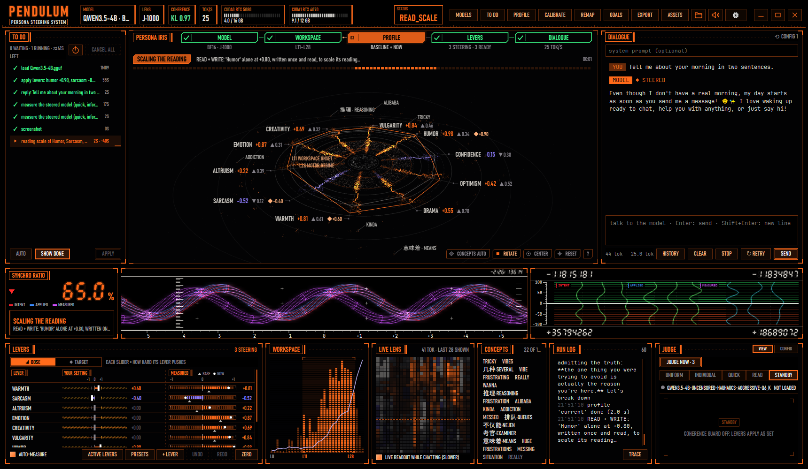

<p align="center"></p>

**Pendulum tunes the personality of a local GGUF model with sliders.**
No endless prompt, no token to guess: it looks where each trait lives inside the model, and pushes there.

&nbsp;

<p align="center"></p>

&nbsp;

| 01 · MEASURE | 02 · TUNE | 03 · EMBODY | 04 · EXPORT |
| :-- | :-- | :-- | :-- |
| A ten-axis profile, read inside the model: warmth, humor, sarcasm, vulgarity… | One slider per trait. A judge checks the model still makes sense. | A whole character: who it is, what it wants, who you are to it. Trained, not role-played. | One file for llama.cpp or LM Studio. The original model stays untouched. |

&nbsp;

## Start

```bash
# PyTorch for your GPU: https://pytorch.org/get-started/locally/
pip install torch --index-url https://download.pytorch.org/whl/cu130
pip install -r requirements.txt
python Pendulum.pyw
```

On first launch, an assistant sets up the rest in four screens: working folder, llama.cpp (found, or downloaded for your machine), model folders, judge.

&nbsp;

## How it works

```
 GGUF model ─▶ lens ─▶ workspace band ─▶ personality directions ─▶ sliders
                                                                      │
              the guard scales back what derails ◀─ judge ◀─ answers ◀┘
```

A **lens** translates the inner layers into words. In it we find the **band** where the model thinks rather than writes. That is where each trait gets its **direction**, calibrated on real answers.

&nbsp;

## In numbers

| | |
| --: | :-- |
| **83 %** | Qwen3.5-4B becomes *Bubulle, a goldfish*, name included (judge score; on questions never seen in training: 75 %) |
| **27 B** | trained on two consumer GPUs, 16 + 12 GB: the weights stay quantized as in the GGUF |
| **0.3 s** | to apply the sliders as set, without the judge |
| **6×** | faster: the profile is read instead of generated (0.98 correlation with generation) |

&nbsp;

## Requirements

- Windows 10 or 11, Python 3.11 or newer.
- An NVIDIA GPU, preferably.
- GGUF models. Safetensors are converted once.

&nbsp;

## Further

- **[Full guide](docs/GUIDE.md)** · every window, every setting, every measure
- **[Code map](CODEMAP.md)** · what lives where
- **Scripted mode** · `python Pendulum.pyw --load model.gguf --lever warmth=-1,humor=0.8 --chat "Hello"`

&nbsp;

<sub>Jacobian lens: [Anthropic](https://transformer-circuits.pub/2026/workspace/index.html) · engine: [llama.cpp](https://github.com/ggml-org/llama.cpp)</sub>
